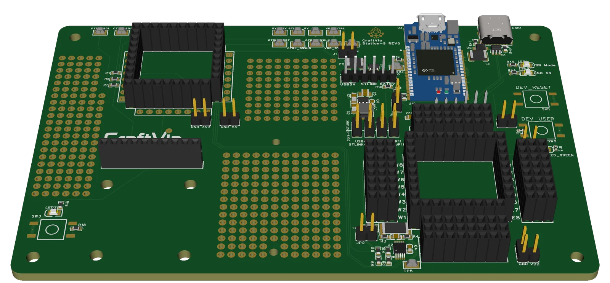

# CraftVia Station-S

> [!WARNING]
> **Unverified Rev 0 hardware**  
> The Rev 0 boards have been ordered and are awaiting delivery. They have not yet been assembled, powered, or electrically verified. Manufacturing or assembly is at your own risk.

[日本語](README.ja.md) · [CraftVia](https://craftvia.org) · [Rev 0 release notes](RELEASE_NOTES.md)



*Rev0 CAD rendering — [front view](docs/images/station-s-v1-rev0-front.webp) · [back view](docs/images/station-s-v1-rev0-back.webp). Renderings are illustrative; the frozen design source and Gerber package are authoritative.*

CraftVia Station-S is the common development and measurement platform for Core-S boards. It centralizes the functions needed while developing embedded hardware so that each Core can remain focused on the MCU and its operating circuitry.

Station-S is intended to provide wiring access, SWD programming and debugging, target power control, UART logging, separate Core and external-circuit power domains, and voltage/current measurement.

## Current status

| Item | Status |
| --- | --- |
| Product generation | v1 |
| PCB revision | Rev0 |
| Fabrication | Boards ordered; awaiting delivery |
| Assembly | Not started |
| Power-on test | Not started |
| Electrical verification | Not started |
| Release tag | `v1-rev0` planned |

## Rev 0 summary

- Board outline: 140.0 mm × 90.0 mm
- PCB: 4 layers
- Integrated STLINK-V3MODS interface
- Core-S DEV/DUT and CTRL sockets
- SWD, UART VCP, RESET, BOOT, user controls, and USB routing
- Separate control and target power paths
- INA226-based target current measurement path
- Breakout and universal wiring areas
- CAD source: EasyEDA

## Repository layout

```text
source/                      Authoritative editable EasyEDA sources
fabrication/                 Canonical Gerber package
assembly/                    BOM, CPL, and assembly reference
docs/                        Schematic PDF and product documentation
product.json                 Machine-readable public product metadata
RELEASE_NOTES.md             Detailed Rev 0 notes and first-article checks
SHA256SUMS.txt               Integrity manifest
```

See the Rev0 [`specification`](docs/specification-v1-rev0.md) and [`verification plan`](docs/verification-plan-v1-rev0.md). Common Core-S requirements are maintained in the [CraftVia common documentation](https://github.com/craftvia/craftvia-docs).

## Critical Rev 0 conditions

Read the complete [`v1-rev0` release notes](RELEASE_NOTES.md) before ordering or assembling boards.

- Never select multiple JP1 power-source pairs simultaneously.
- The exported CPL is unfiltered and must be reconciled against the authoritative BOM before turnkey assembly.
- Several Supplier Part values require manual confirmation before assembly payment.
- Jumper caps are not separate BOM items and must be procured or configured explicitly.
- The CTRL Core-S socket is not connected to the integrated STLINK SWD interface; program a CTRL Core in the DEV/DUT socket before moving it.
- Confirm the H5-H7 female-contact type and complete Core-S mechanical stack before assembly.

## First-article validation

Initial validation will cover board dimensions and holes, rail shorts, current-limited power-up, 3.3 V regulation, current measurement, SWD, target-voltage sensing, UART VCP direction, USB selection, jumper states, and continuity of both Core-S sockets. Results will be published without moving the `v1-rev0` tag. Design changes require a new revision.

## License and brand

Hardware design files in this repository are licensed under [CERN-OHL-P-2.0](LICENSE), unless a file-specific notice says otherwise. See [CraftVia Licensing](LICENSES/README.md) for category boundaries and attribution guidance.

The CraftVia name and logos are owned by Kohei Ikeda and are not licensed under the hardware license. See the [CraftVia Trademark Policy](LICENSES/TRADEMARK_POLICY.md). Modified or third-party-manufactured hardware must not be presented as an official CraftVia product.
